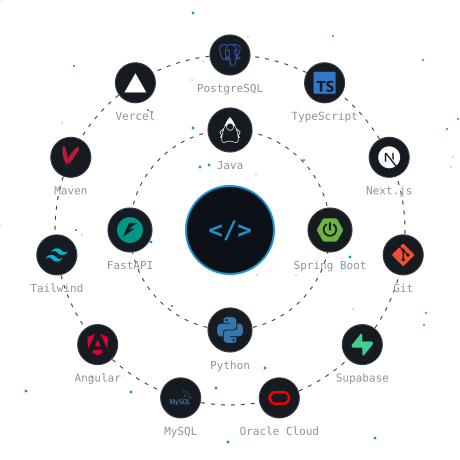

<!-- ===================== HEADER ===================== -->
<div align="center">


<a href="https://github.com/Fernan-04">
  
</a>

<p>
  <a href="https://www.linkedin.com/in/jose-eduardo-diaz-fernandez/"></a>
  <a href="mailto:diazfernan02042005@gmail.com"></a>
  
</p>

</div>

<div align="center">
  
</div>

---

## Sobre mí

Estudiante de **Ingeniería de Software** en la Universidad Tecnológica del Perú (UTP), enfocado en **desarrollo backend con Java y Spring Boot** y en servicios de IA con **Python y FastAPI**. Construyo con arquitectura hexagonal, SDD y TDD.

- Ganador del **Hackathon Internacional de IA UPADI 2026**, entre más de 40 equipos de Latinoamérica
- Desarrollador backend de **Orión Logistic**, un sistema en producción para una empresa de courier
- Lima, Perú · Abierto a oportunidades part-time y por contrato

---

## Proyectos destacados

<table>
  <tr>
    <td width="50%" valign="top">
      <h3>KNexus Engine</h3>
      <p>Motor de IA que descubre y explica conexiones entre proyectos, tesis e investigadores universitarios, rastreando cada conexión hasta el dato que la sustenta. <b>1er puesto — Hackathon UPADI.</b></p>
      <p>
        
        
        
      </p>
      <details>
        <summary><code>$ git log --author=jose</code></summary>
        <ul>
          <li>Desarrollo backend en un equipo de 3, construido en 72 horas</li>
          <li>Arquitectura hexagonal con dominio puro y testeable</li>
          <li>Recuperación híbrida multilingüe (semántica + léxica) con trazabilidad a la fuente</li>
          <li>Reranking explicable con features auditables</li>
        </ul>
      </details>
      <a href="https://github.com/JoaquinStudent/k-nexus-engine">Repositorio →</a>
    </td>
    <td width="50%" valign="top">
      <h3>Orión Logistic</h3>
      <p>Sistema web en <b>producción</b> para una empresa de importación y courier Miami–Perú (~1,000 pedidos/mes).</p>
      <p>
        
        
        
      </p>
      <details>
        <summary><code>$ git log --author=jose</code></summary>
        <ul>
          <li>Autenticación con JWT y Spring Security</li>
          <li>Modelado de entidades JPA sobre PostgreSQL (Supabase)</li>
          <li>Digitaliza un flujo que antes era manual (correos, hojas de cálculo y WhatsApp)</li>
        </ul>
      </details>
      <a href="https://orionlogisticperu.com/">Ver en producción →</a>
    </td>
  </tr>
  <tr>
    <td width="50%" valign="top">
      <h3>FinanceAI</h3>
      <p>Asistente de salud financiera personal — Hackathon Oracle Next Education (130 h). Backend hexagonal + microservicio de Machine Learning.</p>
      <p>
        
        
        
      </p>
      <details>
        <summary><code>$ git log --author=jose</code></summary>
        <ul>
          <li>Desarrollo backend con Spring Boot en arquitectura hexagonal</li>
          <li>Integración con un microservicio de ML en Python (FastAPI + Scikit-Learn)</li>
          <li>Base de datos MySQL desplegada en Oracle Cloud</li>
        </ul>
      </details>
      <a href="https://github.com/No-Country-simulation/G9-LATAM-Team-14">Repositorio →</a>
    </td>
    <td width="50%" valign="top">
      <h3>Markdocs</h3>
      <p>Convierte PDF, Word, PowerPoint y Excel a Markdown limpio en segundos, sin registro y sin guardar archivos.</p>
      <p>
        
        
        
      </p>
      <details>
        <summary><code>$ git log --author=jose</code></summary>
        <ul>
          <li>Proyecto individual full stack, construido en 1 semana</li>
          <li>Backend de conversión en Python + FastAPI, frontend en Next.js 14</li>
          <li>Privacidad por diseño: no almacena los archivos del usuario</li>
        </ul>
      </details>
      <a href="https://conversor-documentos-one.vercel.app/">Probar demo →</a>
    </td>
  </tr>
</table>

<details>
<summary><b>Ver más proyectos</b></summary>
<br>

<table>
  <tr>
    <td valign="top">
      <h3>Sentiment API</h3>
      <p>Gateway REST reactivo que consume un modelo de ML para analizar sentimientos de reseñas en <b>español y portugués</b>, idiomas que la mayoría de herramientas existentes deja de lado.</p>
      <p>
        
        
        
        
        
      </p>
      <details>
        <summary><code>$ git log --author=jose</code></summary>
        <ul>
          <li>Refactor en equipo hacia arquitectura hexagonal (dominio, aplicación, infraestructura y presentación)</li>
          <li>Consumo reactivo del modelo de ML en Python/FastAPI con WebClient</li>
          <li>Seguridad con JWT y BCrypt, validación con Jakarta Validation</li>
        </ul>
      </details>
      <a href="https://github.com/Jona-9/Sentiment-API---Project">Repositorio →</a>
    </td>
  </tr>
</table>

</details>

---

## Tech Stack

<table>
  <tr>
    <td width="55%" align="center">
      
    </td>
    <td width="45%" align="center" valign="middle">
      
    </td>
  </tr>
</table>

---

## Logros y certificaciones

<div align="center">
  
</div>

<details>
<summary><b>Ver IDs de credenciales</b></summary>
<br>

| Certificación | Emisor | ID de credencial |
|---|---|---|
| CCNA: Introducción a las redes | Cisco Networking Academy | `5fdaec46-6dfc-4bf0-9bfd-68e2770a9f16` |
| OCI Certified Foundations Associate 2026 | Oracle | `OC8059561` |
| Programa ONE Tech Advanced | Alura Latam | `fae97bef-42db-48b9-a059-7d80feb9a543` |

</details>

---

## Actividad en GitHub

<br>

<div align="center">
  
  &nbsp;&nbsp;&nbsp;&nbsp;&nbsp;&nbsp;
  
</div>

<br>

<div align="center">
  
</div>

<br>

---

---

<div align="center">

```bash
[jose@arch ~]$ echo $MOTTO
"Construyo backends limpios, testeables y listos para producción."
```

</div>


